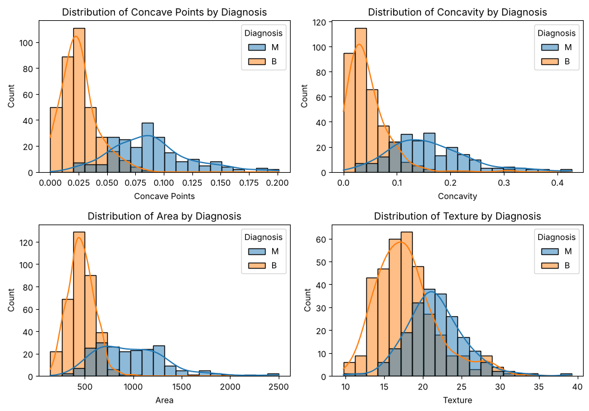
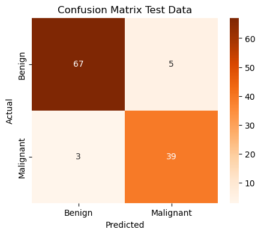
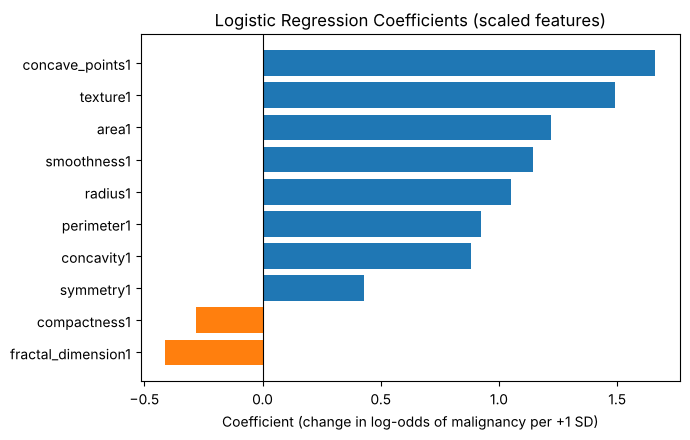

# Flagging Likely-Malignant Breast Masses with Logistic Regression

A decision-support model that classifies breast tissue samples as **malignant** or **benign** from digitized cell-nucleus measurements, built in Python with scikit-learn.

> Course project for DATA 601: Working With Data and Visualization, Master of Data Science and Analytics, University of Calgary (Fall 2026). Team: **Kashif Shafi**, Regan Todd and Naveen Anend.

## The question

Can a computational model determine whether a breast tissue sample is malignant or benign from cell-nucleus measurements?

Pathologists in high-volume labs review many samples every day, so a reliable screening aid could help prioritize their work. We set three goals for the model, on tumours it has never seen:

1. **Catch as many malignant tumours as possible (high recall).** Missing a cancer is far more serious than a false alarm.
2. **Beat the baseline clearly.** Always guessing "benign" is right 63% of the time.
3. **Stay interpretable**, so we can see which measurements push a prediction towards malignant.

## Data

[Breast Cancer Wisconsin (Diagnostic)](https://doi.org/10.24432/C5DW2B), UCI Machine Learning Repository: 569 fine-needle aspiration samples (62.7% benign, 37.3% malignant).

Each sample describes the cell nuclei traced on a digital image. We used the 10 **mean** measurements (radius, texture, perimeter, area, smoothness, compactness, concavity, concave points, symmetry and fractal dimension) and left out the standard-error and "worst" columns, which repeat the same characteristics.



Malignant nuclei are about twice as large on average and have roughly three times as many concave points, so their outlines are much more irregular.

## Approach

1. Checked for missing values (none) and encoded the diagnosis as 0 = benign, 1 = malignant.
2. Split the data 80/20 into training and test sets, stratified on diagnosis with a fixed random seed for reproducibility.
3. Ran **5-fold stratified cross-validation** on the training set, scaling inside each fold so no validation data leaks into training.
4. Standardized all features and trained a **logistic regression** model (lbfgs, L2 regularization, C = 1). The mild regularization keeps coefficients stable for highly correlated features such as radius, perimeter and area.
5. Evaluated on the held-out test set with a confusion matrix, precision, recall and accuracy.
6. Interpreted the scaled coefficients, and refit without radius and perimeter to check the effect of correlated size features.

## Results

| Metric | Value |
|---|---|
| Recall (malignant cases caught) | **92.9%** (39 of 42) |
| Test accuracy | **93.0%** (106 of 114) |
| Precision | 88.6% |
| 5-fold cross-validation accuracy | 94.1% (range 92.3% to 95.6%) |
| Baseline (always predict benign) | 63.2% |

<p>
  
  
</p>

**What drives the prediction:** once the three overlapping size features are combined, **nucleus size** is the strongest single predictor (area's coefficient rises to about 2.5 when it is the only size feature), followed by **concave points** and **texture**. Dropping radius and perimeter left the results unchanged, so one size variable is enough.

## Limitations and next steps

- The model still missed **3 malignant tumours**. That recall is promising but not yet high enough for clinical use.
- All samples come from one clinic in the early 1990s, and the test set is small, so each missed case moves recall by about 2.4 percentage points.
- Next steps: lower the 0.5 decision threshold (tuned on training data only) to flag more borderline cases, compare other classifiers, and validate on independent data.

This is an exploratory decision-support tool, not a replacement for clinical assessment.

## Run it yourself

```bash
pip install -r requirements.txt
jupyter notebook breast_cancer_logistic_regression.ipynb
```

The notebook downloads the data directly from the UCI repository with `ucimlrepo`.

## Tools

Python, pandas, scikit-learn, matplotlib, seaborn, Jupyter
